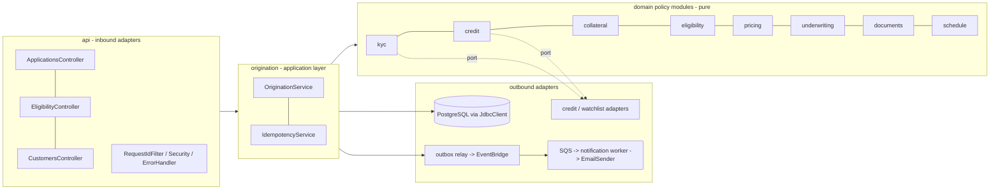
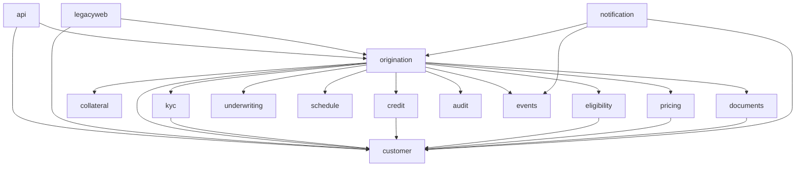
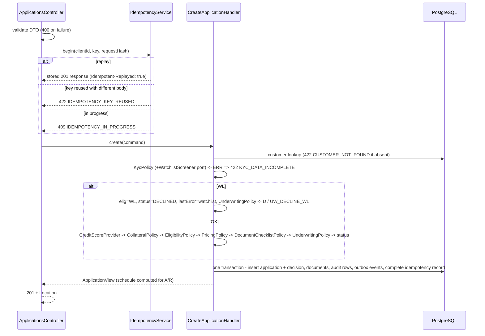
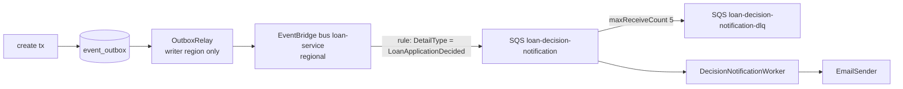
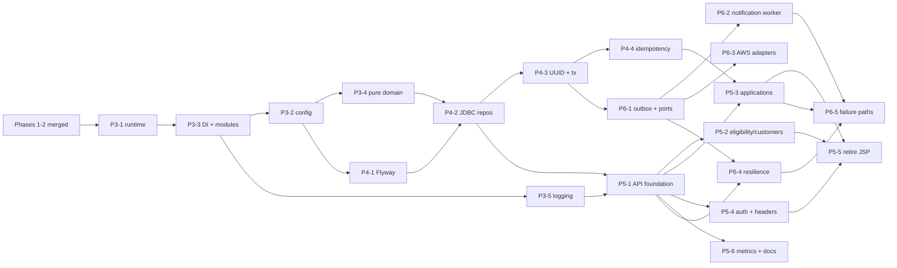

# Technical design: Loan service replatform — phases 3–6

| | |
|---|---|
| **Status** | Draft, aligned to [PRD](prd-replatform.md) (all requirements `Proposed`) |
| **Code baseline** | `main@38dc10a` |
| **Standards** | `enterprise-engineering-standards@750ab9e` |
| **Assumes** | Recommendations in [open-decisions.md](open-decisions.md) (D-1 Spring Boot 3 / Java 21, D-2 modular monolith, D-3 API-only, …). Sections that depend on a decision name it. |

## 1. Summary

One Spring Boot 3 application on Java 21. It is a modular monolith: business modules with ArchUnit-enforced
boundaries, pure domain policies holding today's rules unchanged, and an application layer that orchestrates
them. Spring JDBC repositories write to PostgreSQL (Aurora PostgreSQL Global Database when deployed) with
Flyway-owned migrations. It exposes a versioned JSON API with a standard error envelope, request ids, OIDC
bearer auth, health groups and graceful shutdown. Domain events go through a transactional outbox to
EventBridge, and decision notifications are sent by an SQS-fed worker. Every outbound dependency sits behind
a port, with an in-process fake for local runs and tests and Resilience4j timeouts, retries, circuit breakers
and bulkheads.



## 2. Technology choices

Only stack elements from `standards/platform.md` are used for AWS concerns (`PLAT-09`). Library choices
inside the JVM are listed so reviewers can object early.

| Concern | Choice | Notes |
|---------|--------|-------|
| Runtime | Java 21 LTS, Spring Boot 3.x (pinned to the latest GA 3.x patch at P3-1) | D-1 |
| Build | Maven (existing), Spring Boot parent BOM, Maven Wrapper | WAR packaging until P5-5 (JSP needs WAR), then executable JAR |
| Web | Spring MVC (servlet stack, Tomcat embedded) | Simple blocking model; the legacy code is synchronous |
| Validation | Jakarta Bean Validation (Hibernate Validator) | `SEC-02` |
| Data access | Spring JDBC `JdbcClient`, HikariCP, PostgreSQL JDBC driver | D-13 |
| Migrations | Flyway (+ `flyway-database-postgresql`) | `PLAT-04`: the service owns its schema |
| Security | Spring Security OAuth2 Resource Server (JWT) | `PLAT-03`, `SEC-06` |
| Config | `@ConfigurationProperties` + Spring Cloud AWS (`aws-parameterstore:`, `aws-secretsmanager:` imports) | `PLAT-06` |
| Messaging | AWS SDK v2 EventBridge client; Spring Cloud AWS SQS listener | `PLAT-05`, `aws` profile only |
| Resilience | Resilience4j (Spring Boot 3 starter) | `RES-02`, `RES-03`, `RES-09` |
| Logging | SLF4J + Logback, Spring Boot structured logging (`ecs` JSON format) | `OBS-01` |
| Metrics / tracing | Micrometer (CloudWatch registry in `aws`), Micrometer Tracing + OpenTelemetry bridge, OTLP exporter | `PLAT-07`, `OBS-06` |
| API docs | springdoc-openapi, checked against the committed `openapi/loan-service-v1.yaml` | Contract tests |
| Tests | JUnit 5 (+ vintage engine until all JUnit 4 tests are migrated), AssertJ, Testcontainers (PostgreSQL, Toxiproxy), ArchUnit, Spring Security test, JaCoCo | `TEST-*` |

## 3. Module structure and legacy mapping

### 3.1 Target modules

Root package stays `com.capitalone.loansvc`. Each module is a top-level package. Its **root package is its
public API** (interfaces, records, enums). Implementation lives under `<module>.internal`. Pure policies live
in the module root or `<module>.domain`, and have no framework imports.

| Module | Responsibility | Public API (examples) | Owns tables |
|--------|----------------|-----------------------|-------------|
| `origination` | Use cases: create application, quick eligibility, get application; idempotency; transaction boundary; compliance recording | `OriginationService`, `ApplicationView`, `CreateApplicationCommand`, `EligibilityCheckCommand` | `loan_application`, `idempotency_record` |
| `customer` | Customer reference data and lookup | `CustomerQuery`, `Customer` (record) | `customer` |
| `kyc` | KYC checks and watchlist screening | `KycPolicy`, `KycResult`, `WatchlistScreener` (port) | — |
| `credit` | Credit score retrieval | `CreditScoreProvider` (port), `CreditScore` | — |
| `collateral` | Haircuts and LTV | `CollateralPolicy`, `CollateralAssessment` | — |
| `eligibility` | DTI, payment estimate, eligibility decision | `EligibilityPolicy`, `EligibilityResult` | — |
| `pricing` | Base rate lookup and adjustments | `PricingPolicy`, `RateCard` (port), `PricingResult` | `rate_card` |
| `underwriting` | Decision and compliance code | `UnderwritingPolicy`, `UnderwritingDecision`, `DecisionCode`, `ComplianceCode` | — |
| `schedule` | Amortization | `AmortizationCalculator`, `PaymentInstallment` | — |
| `documents` | Required-document checklist | `DocumentChecklistPolicy`, `DocumentRequirement` | `document_requirement` |
| `audit` | Audit trail | `AuditTrail`, `AuditEntry` | `audit_event` |
| `notification` | Decision notification worker and template | `EmailSender` (port), `DecisionNotificationWorker` | `notification_delivery` |
| `events` | Domain-event publication (outbox + relay + adapters) | `DomainEventPublisher` (port), `DomainEvent` | `event_outbox` |
| `api` | HTTP adapters: controllers, DTOs, error envelope, filters, security config | (none; nothing may depend on `api`) | — |
| `platform` | Shared kernel: money/percent helpers, `Clock`, request context, exceptions, config properties, resilience wiring | `Money`, `RequestContext`, `DependencyUnavailableException`, `LoanProperties` | — |
| `legacyweb` (temporary) | Existing servlets and JSPs moved here unchanged in P3-3; deleted in P5-5 | — | — |

Allowed module dependencies form a DAG, enforced by ArchUnit (RT-03):



Every module may depend on `platform`, and `platform` depends on no module. Policy modules (`kyc`,
`credit`, `collateral`, `eligibility`, `pricing`, `underwriting`, `schedule`, `documents`) never depend on
each other. Only `origination` composes them, which removes today's cross-calls (for example
`InterestRateTable` → `LoanDao`).

### 3.2 Class → target mapping (all 41 classes)

| Legacy class | Target | Change |
|--------------|--------|--------|
| `audit.AuditLogger` | `audit.AuditTrail` + `audit.internal.JdbcAuditTrail` | Injected; message stores ids/codes only (TD-05); joins the caller's transaction |
| `audit.ComplianceEventWriter` | `origination` records the `ComplianceCode` returned by `UnderwritingPolicy` → audit row (`COMPLIANCE`) + `ComplianceDecisionRecorded` outbox event | No stdout dual-write |
| `collateral.CollateralValuator` | `collateral.CollateralPolicy` | Pure; returns `CollateralAssessment` (type, stated, adjusted, ltv) instead of mutating the application |
| `collateral.LtvCalculator` | `collateral.CollateralPolicy` (private) | Unchanged math |
| `credit.BureauResponseParser` | `credit.internal.SyntheticCreditScoreProvider` | Unused `parsePrimaryFactor` dropped; bad payload logged without the payload |
| `credit.CreditBureauClient` | `credit.CreditScoreProvider` (port) + `credit.internal.SyntheticCreditScoreProvider` (default, D-7) | `bureau.mock` → `loan.credit.provider=synthetic`; unused `pullRaw` dropped; Resilience4j-wrapped (P6-4) |
| `credit.CreditScoreCalculator` | `credit.internal.SyntheticCreditScoreProvider` | Unchanged formula (BR-08) |
| `db.AuditDao` | `audit.internal.JdbcAuditTrail` | PostgreSQL; no swallowed failures inside a create transaction |
| `db.CustomerDao` | `customer.internal.JdbcCustomerRepository` | `save` (MERGE) kept only as a test fixture loader; no endpoint uses it today |
| `db.DbUtil` | Deleted: Spring `DataSource`/Hikari + Flyway | `initSchema` → Flyway; `reset` → removed (DATA-09) |
| `db.LoanDao` | `origination.internal.JdbcApplicationRepository`; `lookupBaseRate` → `pricing.internal.JdbcRateCard` | No insert→update fallback (TD-01) |
| `eligibility.EligibilityRules` | `eligibility.EligibilityPolicy` (instance) | Pure: input `EligibilityInput` (applicant, product, amount, term, FICO, LTV), output `EligibilityResult` (code, dti, lastError, `List<AuditFact>`); thresholds from `EligibilityProperties` |
| `kyc.KycChecker` | `kyc.KycPolicy` | Pure; returns `KycResult(status OK/WL/ERR, effectiveEmploymentStatus, auditFacts)`; no mutation (Q-05) |
| `kyc.WatchlistScanner` | `kyc.WatchlistScreener` (port) + `kyc.internal.StaticWatchlistScreener` | Same lists (BR-05) |
| `manager.CustomerManager` | `customer.CustomerQuery` | |
| `manager.DocumentManager` | `documents.DocumentChecklistPolicy` (pure) + `documents.internal.JdbcDocumentRepository` | Rules separated from SQL |
| `manager.LoanApplicationManager` | `origination.OriginationService` (+ `internal.CreateApplicationHandler`, `internal.EligibilityCheckHandler`) | Same step order (§5); transaction + idempotency |
| `model.CollateralItem` | `collateral.CollateralAssessment` (record) | |
| `model.Customer` | `customer.Customer` (record) | Immutable |
| `model.LoanApplication` | `origination.Application` (aggregate) + `CreateApplicationCommand` + `ApplicationView` | Bean split into input, aggregate and read model |
| `model.PaymentInstallment` | `schedule.PaymentInstallment` (record) | |
| `model.UnderwritingDecision` | `underwriting.UnderwritingDecision` (record) | |
| `notify.EmailTemplateUtil` | `notification.internal.DecisionEmailTemplate` | Same text (BR-19) |
| `notify.NotificationDispatcher` | `notification.DecisionNotificationWorker` + `EmailSender` port + `internal.LoggingEmailSender` | Async; logs `applicationId` + decision only |
| `pricing.InterestRateTable` | `pricing.PricingPolicy` + `pricing.RateCard` port (`JdbcRateCard`, with the same fallback map and 12% default) | |
| `pricing.RateAdjustmentHelper` | `pricing.PricingPolicy` | Unchanged math (BR-14) |
| `schedule.AmortizationCalculator` | `schedule.AmortizationCalculator` | Unchanged (BR-18) |
| `schedule.PaymentScheduleBuilder` | `schedule.AmortizationCalculator` (method) | Merged; called on read (TD-03) |
| `underwriting.DecisionCodes` | `underwriting.DecisionCode` enum (`A`,`D`,`R`,`E` + descriptions) | Wire values unchanged |
| `underwriting.UnderwritingEngine` | `underwriting.UnderwritingPolicy` | Pure; returns decision + `ComplianceCode` |
| `util.AppContext` | Deleted (Spring DI) | RT-02 |
| `util.ConfigHolder` | Deleted (`LoanProperties`, `EligibilityProperties`, …) | RT-05 |
| `util.DateHelper` | Deleted (`java.time` + injected `Clock`) | |
| `util.MoneyHelper` | `platform.Money` | Same rounding; `parseMoney` only in `legacyweb` until P5-5 |
| `util.StringHelper` | `platform.Strings` (only the helpers still used) | |
| `web.AdminReloadServlet` | Removed in phase 2 (PR #2) | — |
| `web.AppStartupListener` | Deleted (Spring lifecycle) | |
| `web.CustomerServlet` | `legacyweb` (P3-3) → `api.CustomersController` (P5-2); deleted P5-5 | |
| `web.EligibilityServlet` | `legacyweb` → `api.EligibilityController` (P5-2) | |
| `web.LoanApplyServlet` | `legacyweb` → `api.ApplicationsController#create` (P5-3) | |
| `web.UnderwriteServlet` | `legacyweb` → `api.ApplicationsController#get` (P5-3) | |
| Phase 2 additions (`HtmlEscaper`, `SecurityHeadersFilter`) | `legacyweb` until P5-5; header set re-implemented in Spring Security config (P5-4) | |

### 3.3 Other artifacts

| Legacy artifact | Target |
|-----------------|--------|
| `schema.sql` | `db/migration/V1__baseline_schema.sql` (§6) |
| `data.sql` (rate card) | `db/migration/V2__rate_card.sql` |
| `data.sql` (customers) | `db/seed/R__seed_customers.sql` (profiles local/test/integration; D-14) |
| `log4j.properties` | Spring Boot logging config (`application.yml`) |
| `WEB-INF/web.xml` | Removed in P3-1 (servlets registered via `ServletRegistrationBean` or `@WebServlet` in `legacyweb`); gone in P5-5 |
| JSPs (`index`, `apply`, `eligibility`, `eligibility-result`, `customer`, `underwriting-result`) | Kept in WAR through phase 4 (with `jakarta` taglibs); deleted in P5-5 (D-3) |
| `ansible/`, `deploy/` | Untouched by phases 3–6 (removed in phase 9) |

### 3.4 Endpoint mapping

| Legacy | Target | Scope (D-5) |
|--------|--------|-------------|
| `GET /apply` (form) | — (API-only, D-3) | — |
| `POST /apply` | `POST /v1/applications` | `loan.application.write` |
| `GET /underwrite?applId=` | `GET /v1/applications/{applicationId}` | `loan.application.read` |
| `GET /eligibility` (form) | — | — |
| `POST /eligibility` | `POST /v1/eligibility` | `loan.eligibility.check` |
| `GET /customer?customerId=` | `GET /v1/customers/{customerId}` | `loan.customer.read` |
| `GET /admin/reload` | Removed (phase 2); no replacement | — |
| `GET /health` (404 today) | `GET /health/live`, `GET /health/ready` | public |

## 4. Boundary enforcement (ArchUnit)

`src/test/java/.../architecture/ArchitectureTest.java` runs in the default suite:

1. **Module DAG:** slices `com.capitalone.loansvc.(*)..` follow §3.1; `slices().should().beFreeOfCycles()`.
2. **Encapsulation:** no class outside module `X` accesses `..X.internal..`.
3. **Pure domain:** classes in policy modules (outside `internal`) and `..domain..` do not depend on
   `org.springframework..`, `jakarta.servlet..`, `java.sql..`, `javax.sql..`, `software.amazon..`, `io.github.resilience4j..`.
4. **Nothing depends on `api` or `legacyweb`.**
5. **No standard streams / `printStackTrace`** (`GeneralCodingRules.NO_CLASSES_SHOULD_ACCESS_STANDARD_STREAMS`).
6. **No field injection**, and no non-final static fields in production code (kills `AppContext`/`ConfigHolder` patterns).
7. **JDBC only in `..internal..` repository classes.**

P3-3 introduces rules 1–7, using `FreezingArchRule` for violations that remain until P3-4. P3-4 must
leave the frozen-violation store empty.

## 5. Use-case flows

### 5.1 Create application (`POST /v1/applications`)

Same business step order as `LoanApplicationManager.processApplication`. Remote calls happen **before**
the DB transaction so no transaction is held open across a network call.



Notes:

- Audit rows keep the legacy event types and order (`APPL` start, `KYC …`, `BUREAU`, `ELIG …`, `COMPLIANCE`,
  `APPL` end). The persistence golden suite compares type sequences, not message text. `NOTIFY` is now
  written by the notification worker when it sends.
- 422 outcomes write no rows. The legacy code left a dangling `APPL process start` audit row for unknown
  customers. That row is dropped as part of BC-07.
- Credit/KYC failure or an open breaker → `DependencyUnavailableException` → `503`. The idempotency record
  is released so the client can retry with the same key (RSL-04).

### 5.2 Quick eligibility (`POST /v1/eligibility`)

Same as `checkEligibilityOnly`: customer lookup (`422` if absent), `KycPolicy` where `WL` → return `WL`
and `ERR` is ignored (Q-03), then credit → collateral → eligibility. Response:
`{eligibilityCheckId, customerId, productCode, eligibilityCode}`. Only audit rows are written (Q-20),
keyed by `eligibilityCheckId` with `subject_type='ELIGIBILITY_CHECK'`, in their own short transaction.
An audit write failure is logged and does not fail the check (BR-21). There is no idempotency key because
no business state is created.

### 5.3 Get application (`GET /v1/applications/{id}`)

Reads `loan_application` and `document_requirement`, and recomputes the payment schedule for `A`/`R`
with `AmortizationCalculator` (deterministic from amount, final rate and term; TD-03).

## 6. Data layer (phase 4)

### 6.1 Legacy → target tables

| Legacy | Target | Column changes |
|--------|--------|----------------|
| `CUST_ACCT` | `customer` | snake_case names; `CREATE_TS` → `created_at timestamptz` |
| `LN_APPL` | `loan_application` | `APPL_ID varchar(30)` → `application_id uuid`; `STATUS_CD` etc. renamed; **adds** `decision_reason`, `approved_amount`, `approved_rate`, `stipulations_required`, `last_error`, `region_id`, `request_id`; NOT NULL + CHECK constraints on codes; FK to `customer` |
| `DOC_CHKLIST` | `document_requirement` | `DOC_ID` identity dropped → PK `(application_id, doc_type)`; `REQ_FLG`/`RCVD_FLG CHAR(1)` → `boolean`; adds `position` to keep checklist order |
| `AUDIT_EVT` | `audit_event` | `EVT_ID BIGINT AUTO_INCREMENT` → `event_id uuid`; `APPL_ID` → `subject_type` + `subject_id uuid`; adds `request_id`, `region_id` |
| `RATE_TBL` | `rate_card` | Names only; `min_fico`/`max_ltv` kept, still unused (Q-12) |
| — | `idempotency_record` | New (P4-4) |
| — | `event_outbox` | New (P6-1) |
| — | `notification_delivery` | New (P6-2) |

H2-specific constructs and their replacements: `MERGE INTO … KEY(…)` → `INSERT … ON CONFLICT (…) DO UPDATE`;
`AUTO_INCREMENT` → app-generated UUID; `DROP ALL OBJECTS` → none (tests use fresh containers);
`MODE=Oracle` → native PostgreSQL; `CURRENT_TIMESTAMP` → `now()`.

### 6.2 Migrations (sketch)

Flyway, schema `loan_svc` (`spring.flyway.schemas=loan_svc`, `default-schema=loan_svc`). Files are
immutable once merged.

```sql
-- V1__baseline_schema.sql (P4-1)
CREATE TABLE customer (
  customer_id       varchar(20)  PRIMARY KEY,
  first_name        varchar(60),
  last_name         varchar(60),
  ssn_last4         varchar(4),
  employer_name     varchar(120),
  employment_status varchar(20),
  annual_income     numeric(14,2),
  monthly_debt      numeric(14,2),
  email             varchar(120),
  phone             varchar(20),
  created_at        timestamptz  NOT NULL DEFAULT now()
);

CREATE TABLE rate_card (
  product_code varchar(20)  PRIMARY KEY,
  base_rate    numeric(8,4) NOT NULL,
  min_fico     integer,
  max_ltv      numeric(8,4)
);

CREATE TABLE loan_application (
  application_id        uuid          PRIMARY KEY,
  customer_id           varchar(20)   NOT NULL REFERENCES customer (customer_id),
  product_code          varchar(20)   NOT NULL,
  requested_amount      numeric(14,2) NOT NULL,
  term_months           integer       NOT NULL,
  purpose_code          varchar(40),
  collateral_type       varchar(40),
  collateral_value      numeric(14,2),
  fico_score            integer,
  ltv_pct               numeric(8,4),
  dti_pct               numeric(8,4),
  base_rate             numeric(8,4),
  final_rate            numeric(8,4),
  eligibility_code      varchar(10)   NOT NULL CHECK (eligibility_code IN ('Y','N','WL','ERR')),
  decision_code         varchar(1)    NOT NULL CHECK (decision_code IN ('A','D','R','E')),
  status_code           varchar(20)   NOT NULL CHECK (status_code IN ('APPROVED','REFER','DECLINED')),
  decision_reason       varchar(200),
  approved_amount       numeric(14,2),
  approved_rate         numeric(8,4),
  stipulations_required boolean       NOT NULL DEFAULT false,
  last_error            varchar(200),
  region_id             varchar(32)   NOT NULL,
  request_id            varchar(64),
  created_at            timestamptz   NOT NULL,
  updated_at            timestamptz   NOT NULL
);
CREATE INDEX ix_loan_application_customer ON loan_application (customer_id, created_at DESC);

CREATE TABLE document_requirement (
  application_id uuid        NOT NULL REFERENCES loan_application (application_id) ON DELETE CASCADE,
  doc_type       varchar(40) NOT NULL,
  position       smallint    NOT NULL,
  required       boolean     NOT NULL,
  received       boolean     NOT NULL,
  PRIMARY KEY (application_id, doc_type)
);

CREATE TABLE audit_event (
  event_id     uuid         PRIMARY KEY,
  subject_type varchar(20)  NOT NULL CHECK (subject_type IN ('APPLICATION','ELIGIBILITY_CHECK')),
  subject_id   uuid         NOT NULL,
  event_type   varchar(40)  NOT NULL,
  message      varchar(500) NOT NULL,
  request_id   varchar(64),
  region_id    varchar(32)  NOT NULL,
  occurred_at  timestamptz  NOT NULL
);
CREATE INDEX ix_audit_event_subject ON audit_event (subject_id, occurred_at);

-- V2__rate_card.sql (P4-1): same four rows as legacy data.sql
INSERT INTO rate_card (product_code, base_rate, min_fico, max_ltv) VALUES
  ('AUTO', 5.9900, 620, 100.0000), ('MORTGAGE', 6.7500, 640, 95.0000),
  ('HELOC', 7.2500, 660, 85.0000), ('PERSONAL', 9.9900, 660, 0.0000)
ON CONFLICT (product_code) DO UPDATE
  SET base_rate = EXCLUDED.base_rate, min_fico = EXCLUDED.min_fico, max_ltv = EXCLUDED.max_ltv;

-- V3__idempotency.sql (P4-4)
CREATE TABLE idempotency_record (
  scope           varchar(40)  NOT NULL,          -- 'application.create'
  client_id       varchar(100) NOT NULL,          -- JWT azp/client_id (or sub)
  idempotency_key varchar(100) NOT NULL,
  request_hash    char(64)     NOT NULL,          -- SHA-256 of canonical request JSON
  state           varchar(12)  NOT NULL CHECK (state IN ('IN_PROGRESS','COMPLETED')),
  application_id  uuid,
  response_status smallint,
  response_body   jsonb,
  locked_until    timestamptz  NOT NULL,
  created_at      timestamptz  NOT NULL,
  expires_at      timestamptz  NOT NULL,
  PRIMARY KEY (scope, client_id, idempotency_key)
);
CREATE INDEX ix_idempotency_expires ON idempotency_record (expires_at);

-- V4__event_outbox.sql (P6-1)
CREATE TABLE event_outbox (
  event_id        uuid         PRIMARY KEY,
  aggregate_type  varchar(40)  NOT NULL,
  aggregate_id    uuid         NOT NULL,
  event_type      varchar(100) NOT NULL,
  event_version   smallint     NOT NULL,
  payload         jsonb        NOT NULL,
  request_id      varchar(64),
  region_id       varchar(32)  NOT NULL,
  created_at      timestamptz  NOT NULL,
  published_at    timestamptz,
  attempts        integer      NOT NULL DEFAULT 0,
  next_attempt_at timestamptz  NOT NULL,
  last_error      varchar(500)
);
CREATE INDEX ix_outbox_pending ON event_outbox (next_attempt_at) WHERE published_at IS NULL;

-- V5__notification_delivery.sql (P6-2): consumer-side dedupe
CREATE TABLE notification_delivery (
  event_id     uuid        PRIMARY KEY,
  application_id uuid      NOT NULL,
  status       varchar(12) NOT NULL CHECK (status IN ('SENT','SKIPPED')),
  delivered_at timestamptz NOT NULL
);
```

Seed customers: `db/seed/R__seed_customers.sql` (repeatable, `INSERT … ON CONFLICT DO UPDATE`), with
the same four rows as legacy `data.sql`. It is on `spring.flyway.locations` only in the `local`, `test`
and `integration` profiles (D-14).

**Migration from `schema.sql`:** no data to move (A2). Cutover is "deploy the new schema". The legacy
H2 schema keeps working on the legacy stack until phase 9.

### 6.3 Pool, timeouts, transactions

- HikariCP: `maximum-pool-size=10`, `minimum-idle=2`, `connection-timeout=3s`, `validation-timeout=1s`,
  `max-lifetime=25m`, `keepalive-time=5m`.
- Session timeouts applied with `connection-init-sql` built from config: `statement_timeout=5s`,
  `lock_timeout=2s`, `idle_in_transaction_session_timeout=10s`. Driver `connectTimeout=3s`, `socketTimeout=10s`.
- `@Transactional` only on application-layer handlers; repositories never open transactions.
  One create = one transaction (DATA-06). Read paths use `readOnly=true`.
- SQL errors are translated by Spring into `DataAccessException`. A shared mapper turns connection,
  timeout and transient failures into `DependencyUnavailableException` (→ `503`). Integrity violations
  are bugs (→ `500`) unless a handler expects them (idempotency PK).

### 6.4 Idempotency (DATA-08, `ARCH-04`)

1. `begin`: `INSERT … ON CONFLICT DO NOTHING` an `IN_PROGRESS` row with `locked_until = now() + lease (30s)`, in its own short transaction.
2. If a row exists: `COMPLETED` with the same hash → replay the stored response; a different hash → `422 IDEMPOTENCY_KEY_REUSED`;
   `IN_PROGRESS` and not expired → `409 IDEMPOTENCY_IN_PROGRESS`; `IN_PROGRESS` with an expired lease → take
   over with a conditional `UPDATE … WHERE locked_until < now()`.
3. Success: the create transaction sets `state=COMPLETED`, the response snapshot and `application_id`, so
   the result and the key commit atomically.
4. Failure (503 or other error): delete the `IN_PROGRESS` row so the client can retry with the same key.
5. Keys are scoped by `client_id` from the token, so two clients can't collide. A scheduled cleanup
   deletes rows past `expires_at` (`loan.idempotency.ttl`, default 24h) and runs only where the relay
   flag is on (writer region).

### 6.5 Aurora Global Database / write forwarding assumptions (verify in phase 8)

The app is region-agnostic and connects to the **regional cluster endpoint** from config
(`PLAT-04`). These assumptions are design inputs for phase 8. They are **not verified** against AWS here:

| # | Assumption | Design consequence |
|---|------------|--------------------|
| W1 | Secondary regions forward DML (INSERT/UPDATE/DELETE incl. `ON CONFLICT`) to the writer; DDL is not forwarded | Flyway runs only against the writer region (deploy step or `spring.flyway.enabled` true only there) |
| W2 | Forwarded writes add cross-region latency | Statement timeout (5s) and the request budget (§10) leave room; measure in phase 8 |
| W3 | Read-after-write consistency for forwarded sessions is configurable | Phase 8 sets session-level consistency so a create followed by a read in the same request is consistent |
| W4 | Row-locking reads (`FOR UPDATE SKIP LOCKED`) may not be appropriate through forwarding | The outbox relay and idempotency cleanup run only in the writer region (`loan.outbox.relay.enabled`) |
| W5 | Any unsupported statement found in phase 8 | Replace it, or document an approved write-affinity policy for that path |

## 7. API (phase 5)

Full sketch: [openapi/loan-service-v1.yaml](openapi/loan-service-v1.yaml).

### 7.1 Conventions

- Base path `/v1`, no servlet context path (BC-02). JSON, `camelCase`, UTF-8.
- **Decimals are JSON strings** at fixed scale (`"25000.00"`, `"6.3650"`) so values round-trip exactly
  and golden comparisons stay exact. Integers (`termMonths`, `ficoScore`) are numbers.
- Timestamps in ISO-8601 UTC. Ids are UUID strings, except `customerId` (D-12).
- Wire values for codes stay as today: `eligibilityCode` `Y|N|WL|ERR`, `decision.code` `A|D|R|E`,
  `status` `APPROVED|REFER|DECLINED`.
- `POST /v1/applications` requires `Idempotency-Key` (1–100 chars of `[A-Za-z0-9_-]`). A replay returns
  the original `201` body with `Idempotent-Replayed: true`.

### 7.2 Error envelope (API-02, `ARCH-03`)

```json
{
  "code": "VALIDATION_FAILED",
  "message": "Request validation failed",
  "details": [{ "field": "termMonths", "issue": "must be between 1 and 600" }],
  "requestId": "6f1c2b8e-3d5a-4e0f-9b1d-2a7c8e4f0a11"
}
```

| HTTP | `code` | When |
|------|--------|------|
| 400 | `VALIDATION_FAILED` | Bean Validation / enum / range errors (`details[]` per field) |
| 400 | `MALFORMED_REQUEST` | Unparsable JSON, wrong types |
| 400 | `IDEMPOTENCY_KEY_REQUIRED` | Missing or invalid `Idempotency-Key` |
| 401 | `UNAUTHENTICATED` | Missing, invalid, expired or wrong-audience token |
| 403 | `FORBIDDEN` | Missing scope |
| 404 | `NOT_FOUND` | Unknown application or customer on GET; unknown route |
| 405 / 406 / 415 | `METHOD_NOT_ALLOWED` / `NOT_ACCEPTABLE` / `UNSUPPORTED_MEDIA_TYPE` | Framework errors, same envelope |
| 409 | `IDEMPOTENCY_IN_PROGRESS` | Same key still processing |
| 422 | `CUSTOMER_NOT_FOUND` | Create/check with an unknown customer (D-9) |
| 422 | `KYC_DATA_INCOMPLETE` | Create with missing customer name (D-9) |
| 422 | `IDEMPOTENCY_KEY_REUSED` | Same key, different request |
| 503 | `DEPENDENCY_UNAVAILABLE` | DB, credit or KYC unavailable, timed out, or breaker open (adds `Retry-After`) |
| 500 | `INTERNAL_ERROR` | Anything else; generic message, details only in logs |

One `@RestControllerAdvice` plus Spring Security's `AuthenticationEntryPoint`/`AccessDeniedHandler` and a
custom `ErrorController` cover every path, including filter-level errors. 4xx are logged at `warn` and 5xx
at `error`, with `requestId` (`OBS-03`).

### 7.3 Request ids (API-04)

`RequestIdFilter` (highest precedence): reads `X-Request-Id`, keeps it if it matches
`^[A-Za-z0-9._-]{1,64}$`, otherwise generates a UUID. It puts the id in the MDC and `RequestContext`, sets the
response header, and the id is copied into error envelopes, audit rows, `loan_application.request_id` and
event metadata. The `traceId` comes from OpenTelemetry and is logged next to it.

### 7.4 Authentication and authorization (API-07/08, D-5)

- Spring Security resource server, stateless (`SessionCreationPolicy.STATELESS`), CSRF off (no cookies).
- `loan.auth.mode=oidc`: `issuer-uri`/`jwk-set-uri` from config; audience validator (`loan.auth.audience`);
  clock skew 60s. Scopes come from `scope`/`scp` and are mapped to `SCOPE_*` authorities.
- `loan.auth.mode=local-hmac` (local/test only, refused by the `aws` profile at startup): HS256 key from
  `LOAN_AUTH_LOCALHMACSECRET` (untracked `.env`). Tests mint tokens with a helper.

| Route | Authority |
|-------|-----------|
| `POST /v1/applications` | `SCOPE_loan.application.write` |
| `GET /v1/applications/*` | `SCOPE_loan.application.read` |
| `POST /v1/eligibility` | `SCOPE_loan.eligibility.check` |
| `GET /v1/customers/*` | `SCOPE_loan.customer.read` |
| `GET /health/live`, `GET /health/ready` | permitAll |
| `GET /v3/api-docs` | permitAll in local/test; disabled in `aws` |
| anything else | denyAll |

### 7.5 Security headers, transport, CORS (API-09)

Spring Security header config: `X-Content-Type-Options: nosniff`, `X-Frame-Options: DENY`,
`Content-Security-Policy: default-src 'none'; frame-ancestors 'none'`, `Cache-Control: no-store`,
`Referrer-Policy: no-referrer`, and HSTS (`max-age=31536000; includeSubDomains`) only when the request is
secure. `server.forward-headers-strategy=framework` makes the request count as secure behind the ALB.
TLS terminates at the ALB (phase 8, `PLAT-02`); local is plain HTTP and we do not claim otherwise. CORS is
disabled unless `loan.http.cors.allowed-origins` is set.

### 7.6 Health and shutdown (API-05/06)

- Actuator health groups: `liveness` = `livenessState`; `readiness` = `readinessState` + `db` + a
  Flyway "migrations current" check. They are exposed with
  `management.endpoint.health.group.liveness.additional-path=server:/health/live` and
  `…readiness.additional-path=server:/health/ready`. `show-details=never`. EventBridge, SQS and email are
  **not** readiness inputs (non-critical, `RES-05`).
- `server.shutdown=graceful`, `spring.lifecycle.timeout-per-shutdown-phase=20s`. On SIGTERM Boot
  publishes `ReadinessState.REFUSING_TRAFFIC`, Tomcat stops accepting connections and in-flight requests
  finish. Outbox relay and SQS listener beans implement `SmartLifecycle` and stop polling first
  (in-flight message → visibility timeout → redelivery), then Hikari closes.
- Phase 8 contract: ECS `stopTimeout` ≥ 30s; ALB deregistration delay ≥ 25s.

## 8. Events and notifications (phase 6)

### 8.1 Ports and local fakes (EVT-01)

| Port | Default (local/test) | `aws` profile adapter |
|------|----------------------|-----------------------|
| `credit.CreditScoreProvider` | `SyntheticCreditScoreProvider` (BR-08) | Same synthetic provider until a real bureau is chosen (D-7) |
| `kyc.WatchlistScreener` | `StaticWatchlistScreener` (BR-05) | Same until a real vendor is chosen (D-7) |
| `events.DomainEventPublisher` (used by the outbox relay) | `InMemoryEventBus` (routes to in-memory queue) | `EventBridgeEventPublisher` (`PutEvents`) |
| Notification queue consumer | `InMemoryQueue` with receive count + DLQ list | Spring Cloud AWS `@SqsListener` |
| `notification.EmailSender` | `LoggingEmailSender` (logs `applicationId`, decision, recipient domain only) | Same until D-16 |

Adapters are chosen by config (`loan.events.publisher`, `loan.credit.provider`, …), not by profile names
in code.

### 8.2 Outbox (EVT-02)

- `OriginationService` calls `DomainEventPublisher.enqueue(event)` **inside** the create transaction. This
  writes an `event_outbox` row; nothing is sent inline.
- `OutboxRelay` (enabled by `loan.outbox.relay.enabled`) polls every `poll-interval` (1s):
  `SELECT … WHERE published_at IS NULL AND next_attempt_at <= now() ORDER BY created_at LIMIT batch-size FOR UPDATE SKIP LOCKED`,
  publishes, then sets `published_at`. On failure it increments `attempts` and sets `next_attempt_at` with
  exponential backoff (cap 5 min). After `max-attempts` (10) it stops retrying, logs an `error` and raises
  the `loan.outbox.failed` metric (alarm in phase 8).
- Delivery is at-least-once. Consumers dedupe on `metadata.eventId` (the notification worker uses
  `notification_delivery`).

### 8.3 Event contracts (EVT-03)

EventBridge `Source`: `com.capitalone.loansvc`. `DetailType` = event type. `Detail`:

```json
{
  "metadata": {
    "eventId": "uuid", "eventType": "LoanApplicationDecided", "eventVersion": 1,
    "occurredAt": "2026-11-22T18:00:00Z", "producer": "loan-service",
    "regionId": "us-east-1", "requestId": "…", "traceId": "…"
  },
  "data": {
    "applicationId": "uuid", "customerId": "C10001", "productCode": "AUTO",
    "requestedAmount": "25000.00", "termMonths": 60,
    "eligibilityCode": "Y", "decisionCode": "A", "statusCode": "APPROVED",
    "finalRate": "6.3650", "approvedAmount": "25000.00", "stipulationsRequired": true
  }
}
```

| Event | Emitted when | `data` fields |
|-------|--------------|---------------|
| `LoanApplicationDecided` v1 | Every persisted application (A/R/D, incl. WL) | as above |
| `ComplianceDecisionRecorded` v1 | Every underwriting decision with a compliance code (BR-20) | `applicationId`, `complianceCode` (`UW_APPROVE`/`UW_REFER`/`UW_DECLINE`/`UW_DECLINE_WL`), `decisionCode` |

Rules: additive changes keep the version; breaking changes add a new `DetailType` version and publish
both versions during migration. No names, email, phone or SSN in payloads (`customerId` is an internal
identifier). JSON Schemas live in `src/main/resources/events/` (P6-1) and payload tests validate against them.

### 8.4 Notification flow and multi-region topology (EVT-04, EVT-06)



- The worker receives a message, inserts into `notification_delivery` (`ON CONFLICT DO NOTHING`, so a
  duplicate is skipped), loads the application and customer email, renders BR-19 (fallback recipient
  `loan.notification.fallback-recipient`), sends, then acks. A send failure means no ack, the message is
  redelivered after the visibility timeout, and goes to the DLQ after 5 receives. If
  `loan.notification.enabled=false`, the worker records `SKIPPED` and acks (preserves `notify.enabled`).
- **Multi-region:** the app tier runs in both regions. Outbox rows replicate with the Global Database.
  Only the **writer region** runs the relay (`LOAN_OUTBOX_RELAY_ENABLED=true`) and publishes to its own
  regional bus, so each event is published once. Each region has a bus, notification queue and DLQ
  (`PLAT-05`: per region, no cross-region hot path). The secondary queue stays idle until a Global
  Database switchover, when the deploy flips the relay flag (SSM) to the new writer. Duplicates around a
  switchover are absorbed by `eventId` dedupe. Cross-region bus routing is added only when a consumer in
  the other region needs the events (none in scope).

## 9. Configuration keys (RT-05, `ARCH-05`, `PLAT-06`)

Env var names follow Spring relaxed binding (upper case, `.` → `_`, `-` removed). Deployed sources:
**task env** (set by the ECS task definition), **SSM** (`/loan-service/<env>/…` via
`spring.config.import=aws-parameterstore:/loan-service/<env>/`), **Secret** (Secrets Manager
`loan-service/<env>/db`, JSON `username`/`password`, via `aws-secretsmanager:`). Business thresholds are
committed defaults and are **not** overridden per environment. Changing one is a PRD behavior change.

| Property | Env var | Default (local) | Deployed source |
|----------|---------|-----------------|-----------------|
| `loan.region.id` | `LOAN_REGION_ID` | `local` | task env |
| `loan.environment` | `LOAN_ENVIRONMENT` | `local` | task env |
| `spring.profiles.active` | `SPRING_PROFILES_ACTIVE` | `local` | task env (`aws`) |
| `spring.datasource.url` | `SPRING_DATASOURCE_URL` | `jdbc:postgresql://localhost:5432/loansvc` | SSM (regional cluster endpoint) |
| `spring.datasource.username` / `password` | `SPRING_DATASOURCE_USERNAME` / `_PASSWORD` | from untracked `.env` | Secret |
| `spring.datasource.hikari.maximum-pool-size` | `SPRING_DATASOURCE_HIKARI_MAXIMUMPOOLSIZE` | `10` | SSM |
| `spring.datasource.hikari.connection-timeout` | `…_CONNECTIONTIMEOUT` | `3000` (ms) | SSM |
| `loan.db.statement-timeout` | `LOAN_DB_STATEMENTTIMEOUT` | `5s` | SSM |
| `loan.db.lock-timeout` | `LOAN_DB_LOCKTIMEOUT` | `2s` | SSM |
| `loan.db.connect-timeout` / `socket-timeout` | `LOAN_DB_CONNECTTIMEOUT` / `LOAN_DB_SOCKETTIMEOUT` | `3s` / `10s` | SSM |
| `spring.flyway.enabled` | `SPRING_FLYWAY_ENABLED` | `true` | task env (`true` in writer region only, W1) |
| `spring.flyway.locations` | — | `classpath:db/migration` (+ `classpath:db/seed` in local/test/integration) | profile |
| `loan.eligibility.dti-limit-default` | — | `43` | committed (was `dti.default`) |
| `loan.eligibility.dti-limit-heloc` | — | `45` | committed (was `dti.heloc`) |
| `loan.eligibility.fico-floor` | — | `620` | committed (was `fico.floor`) |
| `loan.credit.provider` | `LOAN_CREDIT_PROVIDER` | `synthetic` | SSM (was `bureau.mock=Y`) |
| `loan.credit.timeout` | `LOAN_CREDIT_TIMEOUT` | `2s` | SSM |
| `loan.kyc.watchlist-provider` / `timeout` | `LOAN_KYC_WATCHLISTPROVIDER` / `LOAN_KYC_TIMEOUT` | `static` / `2s` | SSM |
| `loan.notification.enabled` | `LOAN_NOTIFICATION_ENABLED` | `true` | SSM (was `notify.enabled`) |
| `loan.notification.fallback-recipient` | `LOAN_NOTIFICATION_FALLBACKRECIPIENT` | `ops@localhost` | SSM |
| `loan.notification.queue-name` | `LOAN_NOTIFICATION_QUEUENAME` | (in-memory) | task env (from CFN output) |
| `loan.notification.consumer-enabled` | `LOAN_NOTIFICATION_CONSUMERENABLED` | `true` | task env |
| `loan.events.publisher` | `LOAN_EVENTS_PUBLISHER` | `in-memory` | task env (`eventbridge`) |
| `loan.events.bus-name` | `LOAN_EVENTS_BUSNAME` | `loan-service` | task env (from CFN output) |
| `loan.events.publish-timeout` | `LOAN_EVENTS_PUBLISHTIMEOUT` | `2s` | SSM |
| `loan.outbox.relay.enabled` | `LOAN_OUTBOX_RELAY_ENABLED` | `true` | SSM per region (writer only) |
| `loan.outbox.poll-interval` / `batch-size` / `max-attempts` | `LOAN_OUTBOX_POLLINTERVAL` / `…_BATCHSIZE` / `…_MAXATTEMPTS` | `1s` / `50` / `10` | SSM |
| `loan.idempotency.ttl` / `lease` | `LOAN_IDEMPOTENCY_TTL` / `LOAN_IDEMPOTENCY_LEASE` | `24h` / `30s` | SSM |
| `loan.auth.mode` | `LOAN_AUTH_MODE` | `local-hmac` | task env (`oidc`; `local-hmac` refused in `aws`) |
| `loan.auth.issuer-uri` / `jwk-set-uri` | `LOAN_AUTH_ISSUERURI` / `LOAN_AUTH_JWKSETURI` | — | SSM |
| `loan.auth.audience` | `LOAN_AUTH_AUDIENCE` | `loan-service` | SSM |
| `loan.auth.local-hmac-secret` | `LOAN_AUTH_LOCALHMACSECRET` | from untracked `.env` (≥ 32 bytes) | never set |
| `loan.http.cors.allowed-origins` | `LOAN_HTTP_CORS_ALLOWEDORIGINS` | empty (off) | SSM |
| `loan.shutdown.timeout` → `spring.lifecycle.timeout-per-shutdown-phase` | `SPRING_LIFECYCLE_TIMEOUTPERSHUTDOWNPHASE` | `20s` | task env |
| `server.port` | `SERVER_PORT` | `8080` | task env |
| `logging.structured.format.console` | — | `ecs` | committed |
| `management.tracing.sampling.probability` | `MANAGEMENT_TRACING_SAMPLING_PROBABILITY` | `1.0` | SSM (e.g. `0.1`) |
| `management.otlp.tracing.endpoint` | `MANAGEMENT_OTLP_TRACING_ENDPOINT` | unset (no export) | task env (collector sidecar) |
| `management.cloudwatch.metrics.export.enabled` / `namespace` | `…_ENABLED` / `…_NAMESPACE` | `false` / `loan-service` | task env |
| `resilience4j.*` (per instance, §10) | — | §10 values | committed, SSM override allowed |

`.env.example` (P3-2) lists every env var above with empty or placeholder values (`SEC-01`).

## 10. Resilience policies (phase 6)

Request budget: `POST /v1/applications` should finish or fail in < 10s worst case, well under the ALB idle
timeout. That is why in-request dependencies get at most one retry.

| Dependency | Critical? | Timeout | Retry | Circuit breaker | Bulkhead | On failure |
|------------|-----------|---------|-------|-----------------|----------|-----------|
| PostgreSQL | Yes | connect 3s, statement 5s, lock 2s, pool wait 3s | None in-app (client retries with `Idempotency-Key`) | — (pool is the limit) | Pool 10 | `503 DEPENDENCY_UNAVAILABLE`; readiness DOWN |
| Credit (`CreditScoreProvider`) | Yes | 2s (TimeLimiter) | 2 attempts, 100 ms backoff, jitter; only on timeout/transient | count window 20, failure rate 50%, open 30s, half-open 5 | 20 concurrent | `503`; never a decline (BC-06) |
| Watchlist (`WatchlistScreener`) | Yes | 2s | same as credit | same | 20 | `503`; never treated as "no hit" |
| EventBridge (relay) | No | 2s | relay-level: up to 10 attempts with backoff (row state); SDK retries 2 | breaker open → relay pauses for the open period | 1 relay thread | Row stays pending; outbox-age alarm |
| SQS consume | No | long poll 20s; visibility 60s | redelivery; DLQ after 5 receives | — | listener concurrency 5 | DLQ + depth alarm |
| Email (`EmailSender`) | No | 5s | 3 attempts, 500 ms ×2, jitter | window 20, 50%, open 60s | 5 | Message not acked → redelivery → DLQ |

Implementation: Resilience4j annotations or decorators on the **adapter** beans (`internal` packages), so
policies stay out of domain code. Breaker state is exported to Micrometer.

## 11. Observability

- **Logs (RT-06/07):** Spring Boot structured logging (`ecs` JSON) to stdout → CloudWatch Logs via the
  ECS log driver (phase 8). MDC: `requestId`, `traceId`, `spanId`, `applicationId` (once known),
  `region`. A Logback `MaskingConverter` is a safety net, but the main control is never passing PII to
  log calls (reviewed, and tested by the golden log-capture test).
- **Metrics (API-11):** `http.server.requests` (route, status), `loan.decisions` (product, eligibility,
  decision), `loan.eligibility.checks` (code), `hikaricp.*`, `loan.outbox.pending`, `loan.outbox.oldest.age`,
  `loan.outbox.failed`, `loan.notifications` (result), `resilience4j.circuitbreaker.state`.
- **Tracing:** Micrometer Tracing + OTel bridge; OTLP to an ADOT collector sidecar → X-Ray (phase 8).
  Trace context goes into EventBridge `metadata.traceId` and the SQS message attributes.
- **SLIs (API-12, illustrative for `standard` tier, D-4):** availability = non-5xx ratio of `/v1/**`
  ≥ 99.9% / 30d per region; latency = p95 `POST /v1/applications` < 500 ms and `POST /v1/eligibility`
  < 300 ms; readiness = ratio of healthy targets per region.

## 12. Testing strategy

| Layer | Tooling | Covers |
|-------|---------|--------|
| Domain unit | JUnit 5, AssertJ; plain `new` | All `BR-*`; golden suite on the domain (PAR-02) |
| Architecture | ArchUnit | §4 rules |
| Persistence | Testcontainers PostgreSQL, Flyway | Migrations, repositories, transactions, idempotency races, golden suite on DB |
| API | `@SpringBootTest` + MockMvc, Testcontainers, Spring Security test JWTs | Contract (OpenAPI validator), envelope, validation, auth, headers, request id, golden suite via HTTP |
| Messaging | In-memory bus/queue; stubbed AWS SDK clients | Outbox relay, dedupe, DLQ, adapter request shapes |
| Failure paths | Testcontainers Toxiproxy (DB latency/down), slow/failing fakes | RSL-05 scenarios |
| Coverage | JaCoCo | PAR-04 report |

All of these run in `mvn -B verify` with Docker only (`TEST-06`). Parity details:
[behavior-parity.md](behavior-parity.md).

## 13. Delivery plan: ordered PRs (phases 3–6)

Every PR: one concern, `mvn -B verify` green, PR body per `templates/pr-body.md` citing PRD IDs and
control IDs, PRD status updated in the same PR.

| PR | Title | Main contents | PRD | Depends on | Size |
|----|-------|---------------|-----|------------|------|
| P3-1 | Runtime: Java 21 + Spring Boot 3 | Boot parent and plugin, Java 21, `javax`→`jakarta` for servlets/JSP/filters (incl. PR #2 classes), WAR + embedded Tomcat/Jasper, JUnit 5 + vintage, Log4j 1 → SLF4J/Logback, H2 1.4 → 2.x **temporarily**, JaCoCo, CI JDK 21 | RT-01, PAR-04 | Phases 1–2 merged; D-1 | M |
| P3-3 | Spring DI + module packages + ArchUnit | Mechanical moves into §3.1 packages (servlets → `legacyweb`); beans replace `AppContext`; ArchUnit rules with freeze | RT-02, RT-03 | P3-1; D-2 | M (mostly moves) |
| P3-2 | Typed config + profiles | `LoanProperties` & co., delete `ConfigHolder`, `.env.example`, `loan.region.id`, Spring Cloud AWS imports (aws profile, inert locally) | RT-05, RT-09 | P3-3 | S |
| P3-5 | Structured logging + PII redaction + CVE scan | JSON logs, MDC, remove stdout/`printStackTrace`, redact notification/audit/KYC logs, log-capture test, CI dependency scan job | RT-06, RT-07, RT-08 | P3-3 | S–M |
| P3-4 | Pure domain policies | Policies + result records; orchestrator owns audit; KYC without mutation; empty the ArchUnit freeze store; domain golden suite | RT-04, PAR-02 | P3-2 | M |
| P4-1 | PostgreSQL + Flyway foundation | `docker-compose.yml` (postgres), V1/V2, seed location, Testcontainers base class, migration tests | DATA-01, DATA-02, DATA-03 | P3-2; D-14 | S–M |
| P4-2 | JDBC repositories on PostgreSQL | `JdbcClient` repositories, Hikari + timeouts, exception mapping, remove H2 + `DbUtil` | DATA-01, DATA-04, DATA-09, DATA-10, NFR-04 | P4-1, P3-4 | M |
| P4-3 | UUID ids + transactional create + full decision | UUIDs, one transaction, no fallback, WL persisted after decision, decision columns, schedule on read; persistence golden suite | DATA-05, DATA-06, DATA-07 | P4-2; D-11 | M |
| P4-4 | Idempotency (service layer) | V3, `IdempotencyService`, race/replay/mismatch tests, cleanup job | DATA-08 | P4-3 | S–M |
| P5-1 | API foundation | `RequestIdFilter`, error envelope + advice + error controller, validation infra, health groups + paths, graceful shutdown | API-02, API-04, API-05, API-06 | P3-5, P4-2 | M |
| P5-2 | Eligibility + customer endpoints | Controllers, DTOs, committed OpenAPI + contract tests | API-01, API-03, API-14 | P5-1; D-9, D-10 | S–M |
| P5-3 | Applications endpoints | `POST`/`GET /v1/applications`, `Idempotency-Key` handling, API golden suite | API-01, API-03, DATA-08 | P5-1, P4-4 | M |
| P5-4 | OIDC auth + scopes + headers | Resource server, local HMAC mode, scope matrix, header/CORS config, auth tests | API-07, API-08, API-09 | P5-1; D-5 | M |
| P5-5 | Retire JSP UI; JAR packaging | Delete `legacyweb`, JSPs, Jasper; JAR packaging; README | API-10 | P5-2, P5-3, P5-4; D-3 | S |
| P5-6 | Metrics, tracing, SLI/scaling docs | Micrometer meters, OTel bridge, CloudWatch registry (aws), README SLIs/Scaling/Health, startup-time check | API-11, API-12, API-13, NFR-01 | P5-1; D-4 | S |
| P6-1 | Ports, outbox, event contracts | `DomainEventPublisher`, V4, relay, in-memory bus, JSON Schemas, compliance event via outbox, §8.4 topology note | EVT-01, EVT-02, EVT-03, EVT-06 | P4-3; D-7 | M |
| P6-2 | Async notification worker | Queue port + in-memory queue/DLQ, worker, V5 dedupe, template parity test | EVT-04 | P6-1 | S–M |
| P6-3 | AWS adapters | EventBridge publisher, SQS listener, SDK timeouts, stubbed-client tests | EVT-05 | P6-1 | S–M |
| P6-4 | Resilience policies | Resilience4j config per §10 on adapters, `503` mapping, breaker metrics, unit tests | RSL-01…RSL-04 | P6-1, P5-1 | M |
| P6-5 | Failure-path suite | Toxiproxy DB down/slow, credit timeout/breaker open, publisher down, poison message | RSL-05 | P6-2, P6-4, P5-3 | S–M |



**Parallel lanes once phases 1–2 merge:** P3-1 → P3-3 are serial (they touch every file). After that, PRs can run in
parallel in these waves: {P3-2, P3-5}, then {P3-4, P4-1}, then {P4-3, P5-1}, then {P4-4, P5-2, P5-4, P5-6,
P6-1}, then {P5-3, P6-2, P6-3, P6-4}, then {P5-5, P6-5}. **Critical path:** P3-1 → P3-3 → P3-2 → P3-4 →
P4-2 → P4-3 → P4-4 → P5-3 → P6-5. **Merge-conflict rule:** P3-1 and P3-3 should merge quickly, because
any PR opened before them must be rebased across the package moves.

## 14. Contract for phases 7–8 (container, CloudFormation)

The container and CloudFormation work running in parallel can build against these values now. They are
the app's side of `PLAT-01`/`PLAT-02`/`PLAT-04`/`PLAT-05`/`PLAT-06`/`PLAT-10`.

| Item | Value |
|------|-------|
| Process | `java -jar` (WAR until P5-5), listens on `8080`, runs as non-root, handles SIGTERM |
| Health | `GET /health/live` (ECS container check), `GET /health/ready` (ALB target group check) |
| Shutdown | App drains in ≤ 20s → ECS `stopTimeout` ≥ 30s; ALB deregistration delay ≥ 25s |
| Startup | Ready in < 30s (NFR-01) → ECS health-check grace period 60s |
| JVM | Container-aware heap, e.g. `-XX:MaxRAMPercentage=75` |
| Required task env | `SPRING_PROFILES_ACTIVE=aws`, `LOAN_REGION_ID`, `LOAN_ENVIRONMENT`, `LOAN_EVENTS_PUBLISHER=eventbridge`, `LOAN_EVENTS_BUSNAME`, `LOAN_NOTIFICATION_QUEUENAME`, `LOAN_AUTH_MODE=oidc`, `SPRING_FLYWAY_ENABLED` (writer region only), `MANAGEMENT_OTLP_TRACING_ENDPOINT` |
| SSM path | `/loan-service/<env>/…` (keys in §9), including per-region `loan.outbox.relay.enabled` |
| Secret | `loan-service/<env>/db` (`username`, `password`), Aurora Global Database regional cluster endpoint in SSM |
| EventBridge | Regional bus `loan-service`; rule `DetailType = LoanApplicationDecided` → notification queue |
| SQS | `loan-decision-notification` + `loan-decision-notification-dlq`, `maxReceiveCount=5`, visibility 60s, per region |
| Task role (least privilege, `IAC-04`) | `events:PutEvents` on the bus; `sqs:ReceiveMessage`, `DeleteMessage`, `ChangeMessageVisibility`, `GetQueueAttributes` on the queue; `secretsmanager:GetSecretValue` on the secret; `ssm:GetParametersByPath` on the path; `kms:Decrypt` for the keys used; CloudWatch `PutMetricData` (namespace `loan-service`) |
| Migrations | Flyway against the writer region only (W1) |

## 15. Risks

| Risk | Mitigation |
|------|------------|
| P3-1 touches every servlet/JSP (`jakarta`) and the build at once | Keep it mechanical and behavior-free; the golden suite must pass unchanged |
| H2 2.x may reject legacy SQL (`MERGE … KEY`, `MODE=Oracle`) during the interim P3-1 → P4-2 window | Verify in P3-1; fallback is to pull P4-1/P4-2 forward and skip H2 2.x |
| Testcontainers needs Docker on CI | GitHub-hosted Ubuntu runners provide it; document a local requirement |
| Write-forwarding behavior differs from §6.5 assumptions | Assumptions isolated (relay/cleanup writer-only, Flyway writer-only); verify in phase 8 |
| Parallel PRs conflict | Ordering in §13; P3-3 moves first; each PR owns distinct files where possible |
| Golden suite depends on the phase‑1 PR | `behavior-parity.md` §4 values were produced from the legacy code and can seed the tests if needed |
| Silent rule drift while refactoring | PAR-03: any expected-value change requires a `BC-*` row |

## 16. Open decisions

See [open-decisions.md](open-decisions.md). This design assumes each recommendation; a different
decision changes the sections that cite it.
