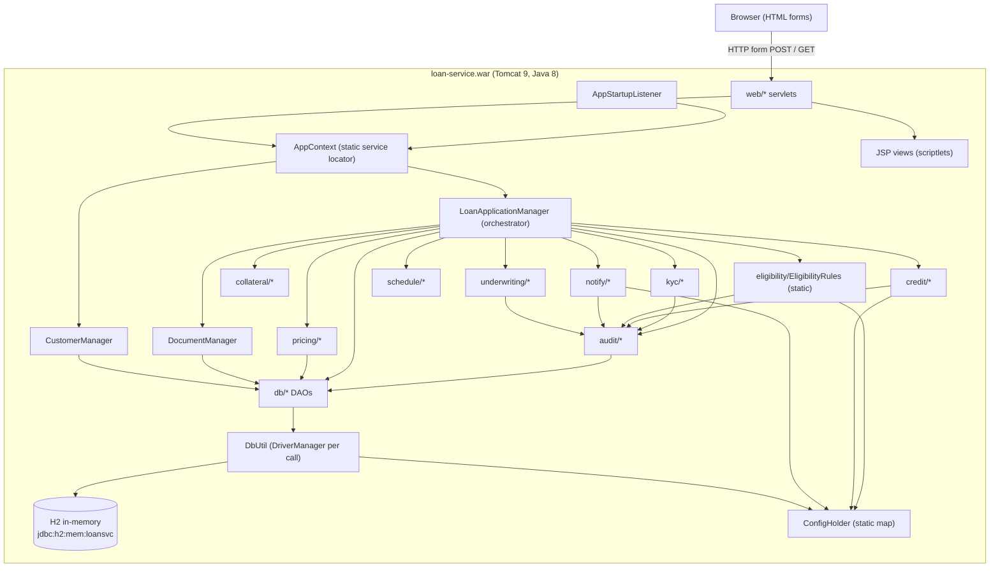

# Architecture

## Shape

A single WAR deployed to one Tomcat instance. No framework, no dependency injection, no service boundaries. All state lives in an in-process H2 database.

## Packages

| Package | Classes | Responsibility |
|---------|---------|----------------|
| `web` | `LoanApplyServlet`, `EligibilityServlet`, `UnderwriteServlet`, `CustomerServlet`, `AdminReloadServlet`, `AppStartupListener` | Parse form params, call managers, forward to JSP |
| `manager` | `LoanApplicationManager`, `CustomerManager`, `DocumentManager` | Orchestration; `DocumentManager` also writes SQL directly |
| `kyc` | `KycChecker`, `WatchlistScanner` | Name/SSN checks, hardcoded watchlist, employment defaulting |
| `credit` | `CreditBureauClient`, `CreditScoreCalculator`, `BureauResponseParser` | Synthetic FICO (mock bureau); live bureau never wired |
| `collateral` | `CollateralValuator`, `LtvCalculator` | Haircuts by collateral type, LTV |
| `eligibility` | `EligibilityRules` | Static eligibility decision; mutates the application and writes audit rows |
| `pricing` | `InterestRateTable`, `RateAdjustmentHelper` | Base rate lookup (DB then fallback), rate adjustments |
| `underwriting` | `UnderwritingEngine`, `DecisionCodes` | Approve / decline / refer |
| `schedule` | `PaymentScheduleBuilder`, `AmortizationCalculator` | Monthly payment and full amortization schedule |
| `notify` | `NotificationDispatcher`, `EmailTemplateUtil` | Builds decision email; prints it to stdout (no SMTP) |
| `audit` | `AuditLogger`, `ComplianceEventWriter` | Log4j + `AUDIT_EVT` row per event; compliance events also to stdout |
| `db` | `DbUtil`, `LoanDao`, `CustomerDao`, `AuditDao` | Raw JDBC with `PreparedStatement`; schema/seed loader |
| `model` | `LoanApplication`, `Customer`, `CollateralItem`, `UnderwritingDecision`, `PaymentInstallment` | Mutable JavaBeans shared across all layers |
| `util` | `AppContext`, `ConfigHolder`, `MoneyHelper`, `StringHelper`, `DateHelper` | Service locator, config bag, helpers |

## Wiring

- `AppStartupListener.contextInitialized` → `AppContext.init()` → `DbUtil.initSchema()` (runs `schema.sql` + `data.sql`) and creates one `LoanApplicationManager`, `CustomerManager`, `DocumentManager`.
- Servlets reach managers through static `AppContext` getters, which lazily init if needed.
- Every class builds its own collaborators with `new` in field initializers. Example: `LoanApplicationManager` creates 12 collaborators; `AuditLogger` is instantiated separately in 6 classes. There are no interfaces, so nothing can be swapped for a fake without code changes.
- `EligibilityRules` is a static class holding a static `AuditLogger`.

## Layering reality

| Concern | Where it actually lives |
|---------|-------------------------|
| Input parsing / defaults | Servlets (`LoanApplyServlet`) **and** `LoanApplicationManager.checkEligibilityOnly` (duplicated) |
| Validation | Scattered: servlets check `customerId` only; `KycChecker`; `EligibilityRules` checks amount last |
| Business rules | Domain packages, but each mixes in audit writes and direct mutation of `LoanApplication` |
| Persistence | DAOs, plus `DocumentManager` with inline SQL; `InterestRateTable` calls `LoanDao` |
| Presentation | JSP scriptlets read model objects directly and print with `<%= %>` (no escaping) |

`LoanApplication` is the shared mutable "bag" that every step reads and writes, so the order of calls in the orchestrator is load-bearing (for example, `RateAdjustmentHelper` depends on `ltvPct` set by `CollateralValuator` and `ficoScore` set by the bureau step).

## Runtime characteristics

- **Stateful:** data is in a per-JVM in-memory H2. Two instances would have two independent databases, so the app cannot be scaled horizontally or run in more than one region as-is.
- **Connections:** `DbUtil.getConnection()` opens a new `DriverManager` connection per DAO call; no pool, no timeouts.
- **Threading:** servlets are singletons; managers hold no request state, but `ConfigHolder` is an unsynchronized `HashMap` and `AppContext.reload()` can drop the database while requests are in flight.
- **Lifecycle:** `contextDestroyed` only prints a message; no drain logic.
- **Health:** no health or readiness endpoint (`/health` returns 404). Ansible treats `GET /loan-service/` returning 200 as healthy.

## Dependencies (`pom.xml`)

| Artifact | Version | Notes |
|----------|---------|-------|
| `javax.servlet-api` | 3.1.0 (provided) | `javax.*` namespace (pre-Jakarta) |
| `javax.servlet.jsp-api` | 2.3.3 (provided) | |
| `jstl` | 1.2 | Declared but JSPs use scriptlets |
| `h2` | 1.4.200 | Known CVEs (e.g. CVE-2021-42392, CVE-2022-23221) |
| `log4j` | 1.2.17 | End of life since 2015; known CVEs (e.g. CVE-2019-17571, CVE-2022-23305) |
| `junit` | 4.13.2 (test) | |
| `jetty-maven-plugin` | 9.4.51 | Local dev server only |
