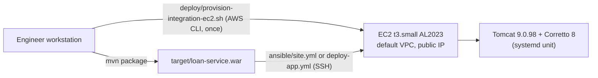

# Configuration and Operations

## Configuration (`util/ConfigHolder`)

A static, unsynchronized `HashMap` populated in a static block. No file, env var, or system property is read. `ConfigHolder.put` exists but is never called, so values are effectively compile-time constants.

| Key | Default | Used by |
|-----|---------|---------|
| `db.url` | `jdbc:h2:mem:loansvc;DB_CLOSE_DELAY=-1;MODE=Oracle` | `DbUtil` |
| `db.user` | `sa` | `DbUtil` |
| `db.pass` | *(empty)* | `DbUtil` |
| `bureau.mock` | `Y` | `CreditBureauClient` |
| `notify.enabled` | `Y` | `NotificationDispatcher` |
| `dti.default` | `43` | `EligibilityRules` |
| `dti.heloc` | `45` | `EligibilityRules` |
| `fico.floor` | `620` | `EligibilityRules` |

Many other business numbers are hardcoded in code rather than config; see [Business Rules](Business-Rules.md).

## Logging

- Log4j 1.2.17, `log4j.properties`: console appender, pattern `%d{yyyy-MM-dd HH:mm:ss} %-5p %c{1} - %m%n`, root `INFO`, `com.capitalone.loansvc` at `DEBUG`.
- Many classes use `System.out.println` and `e.printStackTrace()` instead.
- No request/correlation id. Log lines include application ids and, for notifications, the full email body and customer email address.

Example (from `mvn test`):

```
2026-11-22 18:28:02 INFO  AuditLogger - ELIG LA1795372082818 dti=23.0217
COMPLIANCE_EVT|LA1795372082818|UW_APPROVE
=== EMAIL to jane.nguyen@example.com ===
```

## Local development

| Step | Command |
|------|---------|
| Toolchain | JDK 8+ (compiles with `source/target 1.8`), Maven 3 |
| Test | `mvn test` |
| Package | `mvn package` → `target/loan-service.war` |
| Run | `mvn jetty:run` (port 8080, override with `-Djetty.port=8088`) → `http://localhost:8080/loan-service/` |

Devin VM note: Maven Central may rate-limit (HTTP 429); a `~/.m2/settings.xml` mirror of central works around it.

## Environments

| Environment | URL | Status |
|-------------|-----|--------|
| integration | `http://34.226.211.125:8080/loan-service/` | Live; responded 200 on 2026-11-22 |
| dev | `loan-svc-dev.internal.capitalone.example` | Placeholder, not real |
| prod | `loan-svc.prod.capitalone.example` | Placeholder, not real |

## Integration environment build and deploy



| Piece | Detail |
|-------|--------|
| `deploy/provision-integration-ec2.sh` | Creates key pair (PEM to `deploy/secrets/`, gitignored), security group with **22 and 8080 open to 0.0.0.0/0**, launches t3.small AL2023 in the default VPC, writes Ansible inventory |
| `ansible/site.yml` | Roles `common` (Java 8, tomcat user), `tomcat` (download from archive.apache.org, systemd unit), `loan_app` (copy WAR, restart, wait for `GET /loan-service/` 200) |
| `ansible/deploy-app.yml` | WAR-only redeploy |
| `deploy/run-ansible-site.sh`, `deploy/ansible-bring-up.sh` | WSL helpers; `ansible-bring-up.sh` hardcodes a Windows user path and the host IP |
| `deploy/ec2-tomcat-setup.sh` | Older manual bootstrap script |

Operational properties: single instance, single AZ, plain HTTP, in-place WAR replacement with restart (downtime on every deploy), data wiped on every restart, no monitoring or alarms, no backups (nothing durable to back up).
