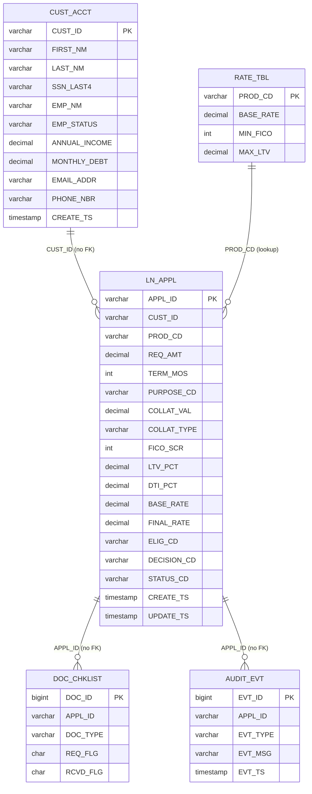

# Data Model

Defined in `src/main/resources/schema.sql`, seeded from `data.sql`. H2 runs in-memory with `MODE=Oracle`; table and column names follow Oracle-style abbreviations. There are no foreign keys, indexes beyond primary keys, or migrations tool; schema is (re)applied at startup with `CREATE TABLE IF NOT EXISTS` and seed rows with `MERGE … KEY(...)`.

## Table access

| Table | Written by | Read by |
|-------|-----------|---------|
| `CUST_ACCT` | seed; `CustomerDao.save` (unused by any endpoint) | `CustomerDao.findById` |
| `LN_APPL` | `LoanDao.insert` / `update` | `LoanDao.findById` (`/underwrite`) |
| `DOC_CHKLIST` | `DocumentManager.persist` (inline SQL) | nothing |
| `AUDIT_EVT` | `AuditDao.write` | nothing |
| `RATE_TBL` | seed | `LoanDao.lookupBaseRate` (`BASE_RATE` only) |

All SQL uses `PreparedStatement` with bound parameters. `SELECT *` is used in `LoanDao.findById`. `DbUtil.reset()` runs `DROP ALL OBJECTS` (H2-specific).

## Not persisted

Customer snapshot at decision time, collateral item details (adjusted value), underwriting reason/stipulations/approved amount, payment schedule, `lastError`. These exist only in the in-memory `LoanApplication` for the duration of the request.

## Sensitive fields

`SSN_LAST4`, `ANNUAL_INCOME`, `MONTHLY_DEBT`, `EMAIL_ADDR`, `PHONE_NBR`, `FICO_SCR`. No column-level encryption or masking; email addresses are written to logs and audit rows.

## Seed data

| CUST_ID | Name | Employer | Status | Income | Monthly debt | SSN last 4 |
|---------|------|----------|--------|--------|--------------|------------|
| C10001 | Jane Nguyen | Acme Corp | EMPLOYED | 92,000 | 1,450 | 4421 |
| C10002 | Marcus Lee | *(null)* | EMPLOYED | 68,000 | 2,100 | 8832 |
| C10003 | Priya Shah | Shah Consulting | SELF_EMPLOYED | 110,000 | 1,800 | 1190 |
| C10004 | Watch Listman | Unknown LLC | EMPLOYED | 50,000 | 900 | 0007 |

`RATE_TBL` seed is in [Business Rules](Business-Rules.md#pricing-pricing).

## Portability notes

H2-specific syntax that will not run unchanged on PostgreSQL: `MERGE INTO … KEY(...)` (seed and `CustomerDao.save`), `BIGINT AUTO_INCREMENT`, `DROP ALL OBJECTS`, and the `MODE=Oracle` URL flag.
