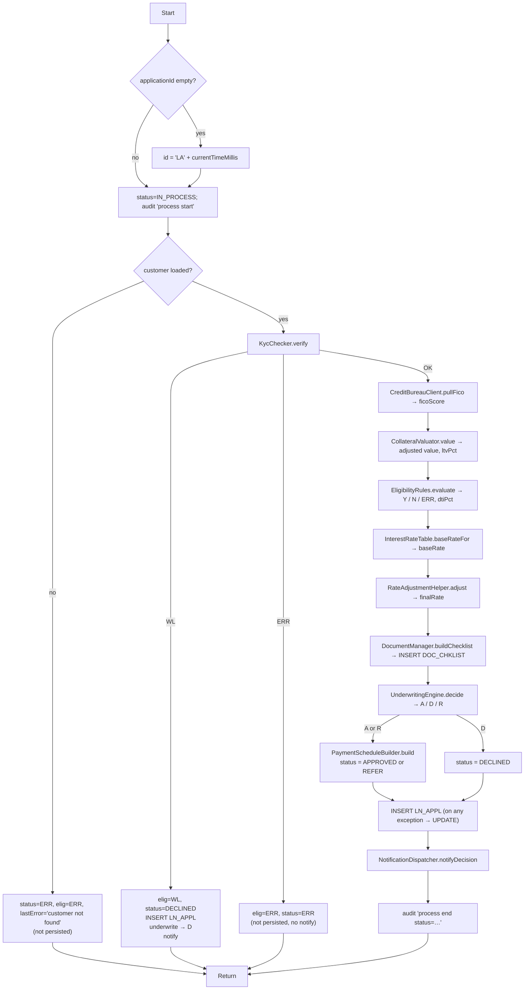
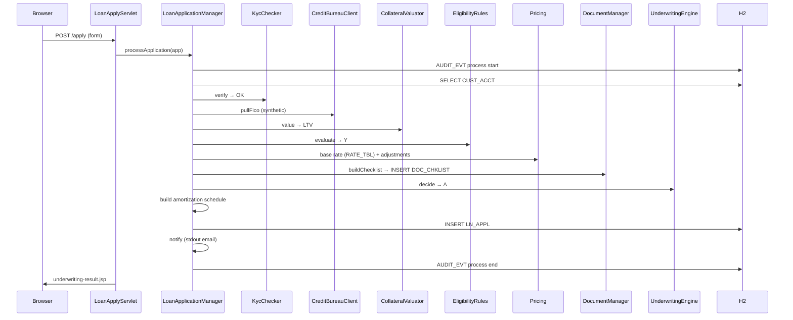

# Loan Processing Flow

Two entry points in `LoanApplicationManager` carry all business behavior.

## `processApplication` (`POST /apply`)

Notes on ordering that the current behavior depends on:

1. Pricing, documents and underwriting run **even when eligibility is `N` or `ERR`**. A declined application still gets a base/final rate and a document checklist.
2. `DOC_CHKLIST` rows are written **before** the `LN_APPL` row.
3. On the watchlist path the `LN_APPL` row is inserted **before** underwriting runs, so `DECISION_CD` is stored as `NULL` even though the in-memory result is `D`.
4. Customer-not-found and KYC `ERR` paths return without persisting the application or sending a notification.
5. The insert-then-update fallback catches **any** exception from `insert`, not only duplicate keys.

## `checkEligibilityOnly` (`POST /eligibility`)

Quick check without persisting an application.

1. Builds a `LoanApplication` with id `"EL" + currentTimeMillis`, parsing amount, term (default 36 on parse failure) and collateral from strings.
2. Customer not found → `ERR`.
3. KYC: `WL` → returns `WL`. **KYC `ERR` is ignored** here (unlike `processApplication`), so evaluation continues.
4. Credit pull → collateral valuation → `EligibilityRules.evaluate`.
5. Returns `Y` / `N` / `ERR` / `WL`.

Side effects: no `LN_APPL` row, but audit rows are written (`BUREAU`, `ELIG`, `KYC`) under the `EL…` id.

## Sequence (happy path)

## Observed outcomes (seed data)

From the integration environment and local tests on 2026-11-22, `POST /eligibility` with `AUTO`, 20,000 over 48 months, `AUTO` collateral 28,000:

| Customer | Synthetic FICO | Result | Why |
|----------|----------------|--------|-----|
| C10001 | 661 | `Y` | Clean path |
| C10002 | 619 | `N` | FICO below 620 floor (income 68k, DTI 37% → −30) |
| C10003 | 665 | `Y` | Self-employed −15 on score; +0.25% on rate when applying |
| C10004 | — | `WL` | Customer id on hardcoded watchlist |

FICO values are computed by `CreditScoreCalculator` (see [Business Rules](Business-Rules.md#credit-score-synthetic-bureau)).
