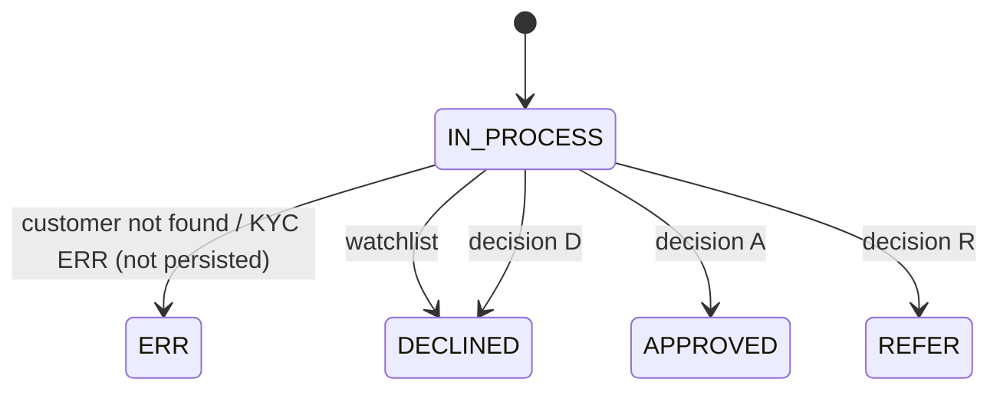

# Status and Decision Codes

All codes are plain strings; there are no enums except constants in `DecisionCodes`.

## Eligibility code (`LN_APPL.ELIG_CD`)

| Code | Meaning | Produced by |
|------|---------|-------------|
| `Y` | Eligible | `EligibilityRules` |
| `N` | Not eligible (FICO, DTI, or mid-FICO LTV) | `EligibilityRules` |
| `WL` | Watchlist hit | `LoanApplicationManager` from KYC `WL` |
| `ERR` | Missing customer, KYC error, or non-positive amount | Manager, `EligibilityRules`, servlet |

## KYC result (not persisted)

`OK`, `WL`, `ERR` from `KycChecker.verify`.

## Underwriting decision (`LN_APPL.DECISION_CD`)

| Code | `DecisionCodes.describe` |
|------|--------------------------|
| `A` | Approved |
| `D` | Declined |
| `R` | Refer to underwriter |
| `E` | Error / incomplete |

## Application status (`LN_APPL.STATUS_CD`)

There is no transition out of `APPROVED`, `REFER` or `DECLINED` (no booking, manual review completion, or withdrawal flow). `IN_PROCESS` is never persisted because the row is written at the end.

## Other string flags

| Field | Values |
|-------|--------|
| `CUST_ACCT.EMP_STATUS` | `EMPLOYED`, `SELF_EMPLOYED` (free text otherwise) |
| `LN_APPL.PROD_CD` | `AUTO`, `MORTGAGE`, `HELOC`, `PERSONAL` (not validated; anything is accepted) |
| `LN_APPL.COLLAT_TYPE` | `AUTO`, `HOME`, `RE`, `NONE`, `UNSECURED` (free text accepted) |
| `DOC_CHKLIST.REQ_FLG` / `RCVD_FLG` | `Y` / `N` |
| `CustomerManager.saveCustomer` return | `OK` / `ERR` (method is not called by any servlet) |
