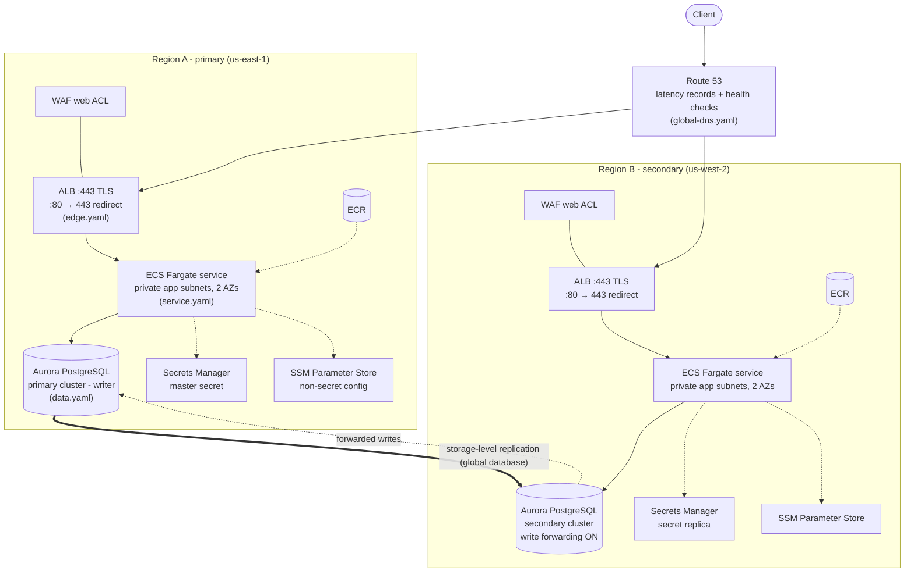

# loan-service AWS infrastructure (CloudFormation)

CloudFormation templates for the standards target in
[`enterprise-engineering-standards/standards/platform.md`](https://github.com/hocragekey/enterprise-engineering-standards/blob/main/standards/platform.md):
ECS/Fargate behind a regional ALB with TLS and AWS WAF in **two active regions**,
Route 53 latency routing with health checks, and an **Aurora PostgreSQL Global
Database with write forwarding** (`PLAT-01`, `PLAT-02`, `PLAT-04`, `PLAT-10`).
CloudFormation is the only IaC tool used (`IAC-01`).

> **Nothing here has been deployed by this PR.** See [Non-claims](#non-claims).

## Layout

| Path | Purpose |
|------|---------|
| `cloudformation/network.yaml` | Regional VPC: 2 AZs, public (ALB/NAT), private app, private data subnets; NAT; S3 gateway + interface endpoints; flow logs |
| `cloudformation/ecr.yaml` | Regional ECR repository: scan on push, immutable tags, KMS, lifecycle, optional registry replication |
| `cloudformation/data.yaml` | Aurora PostgreSQL Global Database member (primary or secondary), multi-Region KMS key, master secret, DB alarms |
| `cloudformation/edge.yaml` | Internet-facing ALB, HTTPS listener (TLS 1.3 policy) + HTTP→HTTPS redirect, target group, WAF web ACL + logs |
| `cloudformation/service.yaml` | ECS cluster, Fargate task/service, least-privilege roles, logs, autoscaling, SSM config, ALB/ECS alarms, optional ADOT sidecar |
| `cloudformation/global-dns.yaml` | Route 53 health checks + latency alias records for both regional ALBs, health-check alarms |
| `cloudformation/params/integration/` | Integration parameter files (`<region>/<stack>.json`, `global-dns.json`) |
| `guard/loan-service.guard` | cfn-guard policy rules; `guard/tests/` has the rule unit tests |
| `scripts/validate.sh` | cfn-lint + cfn-guard + parameter-file checks (local and CI) |
| `scripts/deploy-integration.sh` | Change-set deploy of the integration environment (both regions) |

## Architecture



### Two-region active-active topology (`PLAT-10`, `RES-01`, `RES-11`)

- Both regions run the same stacks and serve traffic at the same time.
  Route 53 returns the lowest-latency healthy region; each record is tied to a
  Route 53 health check on the ALB health path, so a failed region drops out
  and the other region takes all traffic.
- Inside each region the ALB, ECS tasks and Aurora instances span two AZs
  (`RES-11`); NAT is per AZ by default (`NatGatewayMode=PerAz`).
- ECS tasks run only in private app subnets with no public IP; Aurora runs in
  private data subnets with no internet route and accepts PostgreSQL only from
  the app security group.
- AWS API traffic (ECR, Logs, Secrets Manager, SSM, KMS, STS, X-Ray) uses
  interface VPC endpoints by default (`CreateInterfaceEndpoints=true`).

### Write-forwarding design (`PLAT-04`)

- `data.yaml` with `RegionRole=primary` creates the `AWS::RDS::GlobalCluster`,
  the writer regional cluster, a multi-Region KMS primary key and the generated
  master secret (`PLAT-06`, `IAC-03`).
- `RegionRole=secondary` creates a KMS replica key and a regional cluster that
  joins the global cluster with `EnableGlobalWriteForwarding: true`.
- The app in **every** region connects to its **local** cluster endpoint
  (`/<service>-<env>/db/host` in SSM). Reads are served locally; in the
  secondary region, DML is forwarded by Aurora to the global writer, so there
  is one writer and no multi-master conflict handling.
- The cluster parameter group sets `apg_write_forward.consistency_mode=session`
  (read-your-writes within a session) and `rds.force_ssl=1`.
- Forwarded writes add cross-region latency. Latency-sensitive write paths can
  be routed to the primary region later; this PR does not do that.
- Regional failover (promote the secondary, `RES-08`) is an operational runbook
  step (`aws rds failover-global-cluster` / switchover); the
  `GlobalReplicationLagAlarm` (`AuroraGlobalDBReplicationLag`) tracks the RPO.

## Stack order

Stacks are regional; names are `<prefix>-<stack>` in each region (integration
prefix: `loan-svc-integration-`). Cross-stack values use exports from the
same region.

| # | Stack | Region | Template | Depends on |
|---|-------|--------|----------|------------|
| 1 | `network` | primary | `network.yaml` | - |
| 2 | `ecr` | primary | `ecr.yaml` | - |
| 3 | `data` (primary) | primary | `data.yaml` | 1 |
| 4 | `network` | secondary | `network.yaml` | - |
| 5 | `ecr` | secondary | `ecr.yaml` | - |
| 6 | `data` (secondary) | secondary | `data.yaml` | 4, 3 (`PrimaryKmsKeyArn`, `PrimaryDbSecretArn`) |
| 7 | `data` (primary) update | primary | `data.yaml` | 6 - sets `SecretReplicaRegion` so the master secret replicates into the secondary region using the KMS replica key |
| - | push image | both | - | 2, 5 - the image with the same immutable tag in each regional repository |
| 8 | `edge` | both | `edge.yaml` | 1/4 |
| 9 | `service` | both | `service.yaml` | 1-8 in that region |
| 10 | `global-dns` | us-east-1 | `global-dns.yaml` | 8 in both regions |

Teardown is the reverse order: `global-dns` → `service` → `edge` (both regions)
→ secondary `data` → primary `data` → `ecr`/`network`. KMS keys, the master
secret and ECR repositories have `DeletionPolicy: Retain` and are left behind
on purpose.

## Key parameters

Production defaults in the templates are the compliant values; the integration
parameter files override only cost knobs.

| Template | Parameter | Default (prod) | Integration | Notes |
|----------|-----------|----------------|-------------|-------|
| all | `EnvironmentName` / `ServiceName` | - / `loan-service` | `integration` / `loan-svc` | Resource names are `<ServiceName>-<EnvironmentName>-…` → `loan-svc-integration-…` |
| network | `VpcCidr` (+ subnet CIDRs) | `10.20.0.0/16` | `10.60.0.0/16` (us-east-1), `10.61.0.0/16` (us-west-2) | New VPCs; avoid `10.0/16`, `10.42/16`, `10.204/16`, `172.31/16` in the integration account |
| network | `NatGatewayMode` | `PerAz` | `Single` | Single NAT = AZ dependency for egress (integration only) |
| network | `CreateInterfaceEndpoints` | `true` | `false` | Integration sends AWS API traffic through NAT |
| ecr | `IsReplicationSource` | `false` | `false` | See [ECR replication](#ecr-replication) |
| data | `RegionRole` | - | `primary` / `secondary` | |
| data | `InstanceClass` | `db.r6g.large` | `db.serverless` | |
| data | `ServerlessMinCapacity` / `ServerlessMaxCapacity` | `0.5` / `4` | `0.5` / `2` | Serverless v2 minimum |
| data | `CreateReaderInstance` | `true` | `false` | Integration compute is single-AZ (storage stays multi-AZ) |
| data | `DbDeletionProtection` | `true` | `false` | |
| data | `DataDeletionPolicy` | `Retain` | `Snapshot` | Final snapshot on stack delete |
| data | `PrimaryKmsKeyArn`, `PrimaryDbSecretArn` | `""` | from primary outputs | Secondary only (script fills them) |
| data | `SecretReplicaRegion` | `""` | secondary region after step 6 | Primary only (script fills it) |
| edge | `CertificateArn` | `""` | `""` | **Required for production.** Empty = HTTP-only (see gaps) |
| edge | `ContainerPort` / `HealthCheckPath` | `8080` / `/loan-service/` | same | Switch to `/health/ready` when the app exposes it |
| edge | `LoadBalancerDeletionProtection` | `true` | `false` | |
| service | `ImageUri` | - (required) | `<acct>.dkr.ecr.<region>.amazonaws.com/loan-svc-integration:<tag>` | Immutable tag or digest; `latest` is rejected |
| service | `DesiredCount` / `MinCapacity` / `MaxCapacity` | `2` / `2` / `10` | `1` / `1` / `2` | Autoscaling on CPU and ALB requests per target |
| service | `TaskCpu` / `TaskMemory` | `1024` / `2048` | `512` / `1024` | |
| service | `EnableOtelSidecar` | `false` | `false` | `true` adds an ADOT collector sidecar (X-Ray/EMF) |
| service, network, edge | `*RetentionDays` | `90` | `14` | CloudWatch log retention |
| global-dns | `HostedZoneId` / `RecordName` | `""` | `""` | Empty = health checks and alarms only; no DNS records |
| global-dns | `HealthCheckProtocol` | `HTTPS` | `HTTP` | Script takes it from the edge stack's `EdgeProtocol` output |

### Integration-only gaps (documented, not for production)

- **No TLS** (`PLAT-02` gap): without an ACM certificate the ALB listens on
  HTTP :80 only, still behind the WAF web ACL; no :443 listener is created.
  Set `CertificateArn` per region to get HTTPS + HTTP→HTTPS redirect.
- **No DNS records** (`PLAT-10` partial): without a hosted zone, Route 53
  latency records are skipped; clients use each regional ALB DNS name directly.
  Route 53 health checks and alarms are still created.
- **Single NAT, no reader instance, no interface endpoints**: lower cost, less
  AZ resilience (`RES-11` partial).
- **No deletion protection, snapshot on delete**: allows teardown.

### ECR replication

`AWS::ECR::ReplicationConfiguration` is a **registry-wide** setting: deploying
it replaces any existing replication rules in the account. Production can set
`IsReplicationSource=true` in the primary region (with a repository filter) once
the account owner confirms no other rules exist. Integration leaves it off and
pushes the same immutable tag to both regional repositories:

```bash
ACCOUNT=118938645536 TAG=<git-sha>
for REGION in us-east-1 us-west-2; do
  REPO="${ACCOUNT}.dkr.ecr.${REGION}.amazonaws.com/loan-svc-integration"
  aws ecr get-login-password --region "${REGION}" | docker login --username AWS --password-stdin "${REPO%%/*}"
  docker tag loan-service:"${TAG}" "${REPO}:${TAG}"
  docker push "${REPO}:${TAG}"
done
```

## Validate locally (`IAC-10`)

```bash
pip install cfn-lint==1.60.1 pyyaml
# cfn-guard 3.3.0: https://github.com/aws-cloudformation/cloudformation-guard/releases
infra/scripts/validate.sh
```

`validate.sh` runs cfn-lint on every template, the cfn-guard rule unit tests,
cfn-guard against every template, and checks that every parameter file only
uses parameters the template declares. `.github/workflows/cfn.yml` runs the
same script on pull requests that touch `infra/`.

Guard rules (`guard/loan-service.guard`): Aurora encryption with a CMK,
`Retain`/deletion-protection defaults, no publicly accessible DB, KMS rotation
and retention, generated secrets only, no `0.0.0.0/0` or `::/0` ingress except
ports 80/443, ECR scan-on-push + immutable tags, log retention, no wildcard IAM,
private ECS tasks with the deployment circuit breaker, HTTP listeners redirect
(except the `NoCertificate` integration listener), TLS 1.3 policy, WAF on every
ALB template.

## Deploy the integration environment (change sets, `IAC-07`)

Account `118938645536`, primary `us-east-1`, secondary `us-west-2`. Every
stack goes through a change set that is printed before it is executed. The
script refuses to run against any other account.

```bash
# 1. Network, ECR, Aurora global database in both regions (+ secret replication)
infra/scripts/deploy-integration.sh foundation

# 2. Push the image with an immutable tag to both regional repositories
#    (see "ECR replication" above), then:
IMAGE_TAG=<git-sha> infra/scripts/deploy-integration.sh image-check

# 3. ALB + WAF and ECS service in both regions
IMAGE_TAG=<git-sha> infra/scripts/deploy-integration.sh app

# 4. Route 53 health checks/alarms (records only if HostedZoneId is set)
infra/scripts/deploy-integration.sh dns
```

`AUTO_APPROVE=true` executes change sets without the prompt. Each stack step
is equivalent to (example: primary network):

```bash
aws cloudformation deploy \
  --region us-east-1 \
  --stack-name loan-svc-integration-network \
  --template-file infra/cloudformation/network.yaml \
  --parameter-overrides $(python3 -c 'import json;print(" ".join(f"{k}={v}" for k,v in json.load(open("infra/cloudformation/params/integration/us-east-1/network.json")).items()))') \
  --capabilities CAPABILITY_IAM CAPABILITY_AUTO_EXPAND \
  --tags Service=loan-service Environment=integration ManagedBy=cloudformation \
  --no-execute-changeset --no-fail-on-empty-changeset
# review, then execute the change set ARN printed above
aws cloudformation describe-change-set --region us-east-1 --change-set-name <arn>
aws cloudformation execute-change-set  --region us-east-1 --change-set-name <arn>
aws cloudformation wait stack-create-complete --region us-east-1 --stack-name loan-svc-integration-network
```

(`CAPABILITY_AUTO_EXPAND` is needed for `data.yaml`, which uses the
`AWS::LanguageExtensions` transform so `DeletionPolicy` can follow the
`DataDeletionPolicy` parameter.)

After `app`, each region answers on `http://<LoadBalancerDnsName>/loan-service/`
(edge stack output).

## Non-claims

This PR adds templates, policy rules, parameter files and scripts only.

- **No stack has been deployed** by this PR or its author session; no AWS API
  calls were made. `aws cloudformation validate-template` was not run (no
  credentials). Validation is cfn-lint + cfn-guard only.
- Multi-region active-active, Aurora write forwarding, regional failover,
  autoscaling and alarms are **designed and templated, not proven** in a live
  account. No failover or game-day test has been run (`RES-08` evidence is the
  template and runbook design only).
- The current application still uses in-memory H2. `DB_*` environment
  variables and secrets are injected into the task but are **not read by the
  app** until the PostgreSQL migration phase lands, so the deployed service
  would not persist data in Aurora yet.
- Integration settings (HTTP-only, no DNS records, single NAT, single DB
  instance, no deletion protection) are not production-compliant.
- The X-Ray/OTel sidecar is optional and off by default; the app is not yet
  instrumented.
- No production parameter files are included; production needs ACM
  certificates, a hosted zone/record name, an SNS alarm topic, and an account
  owner decision on ECR registry replication.
